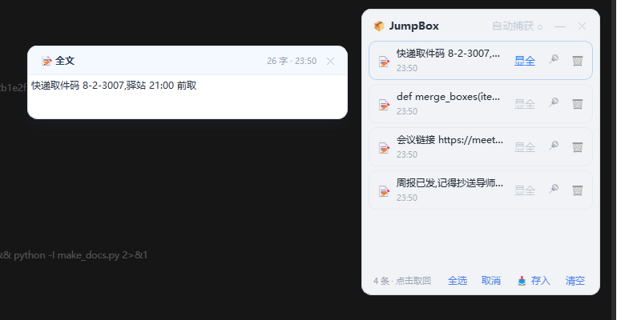

<div align="center">

# 📦 JumpBox

**屏幕上的复制暂存盒 —— 复制的东西先攒着,要用时一键取出**

A tiny always-on-top clipboard staging box for Windows.
Copy things → they wait in the box → click to take them back, one by one or all at once.

</div>

---

## 它解决什么问题

复制只能"一次一份、马上用"?JumpBox 给你一个**常驻屏幕右侧的小盒子**:

- 网页里看到几段想留的话?一路复制,盒子帮你攒着
- 攒完点几下,一次 **Ctrl+V** 按你的顺序全部贴出
- 长文本想看全貌?点「显全」弹出全文气泡

**纯内存、零痕迹**:不读写任何文件,关掉程序一切清空。

## ✨ 功能

| 动作 | 操作 |
|---|---|
| 唤出 | 双击桌面图标,或全局热键 **Ctrl+Alt+B** |
| 存入 | 复制后,在盒子里按 **Ctrl+V**(或点「📥 存入」);也可开启「自动捕获」,任何 Ctrl+C 自动入盒 |
| 单条取回 | 点击条目 → 内容回到剪贴板 → 去 Ctrl+V |
| 多条点选 | **连续点击几条文本**(蓝框标记,再点取消)→ 剪贴板实时合并这几条(按点击顺序)→ 一次 Ctrl+V 全贴出 |
| 全部取出 | 「全选」→ 按**存入时间顺序**合并全部文本 |
| 查看全文 | 「显全」→ 气泡显示全文/大图,文字可选中复制 |
| 固定 | 📌 灰→红,固定项不会被淘汰或清空 |
| 清理 | 「取消」褪去点选高亮;🗑 删单条;「清空」清未固定 |

其他:文字超长自动省略号 + 图片低分辨率缩略图(取回无损)、重复内容自动去重上浮、
上限 30 条(图片 10 张)、置顶常驻可拖动、单实例、托盘常驻、纯中文界面。

## 🖼 界面

<div align="center">
  
  &nbsp;&nbsp;
  
</div>

## 📥 安装

**方式一:下载打包好的 exe(推荐,免装 Python)**

到 [Releases](../../releases) 下载 `JumpBox-v1.0.0-windows-x64.zip`,解压到任意目录,双击 `JumpBox.exe`。
建议:右键 `JumpBox.exe` → 发送到桌面快捷方式;想开机自启就把快捷方式放进 `shell:startup`。

> 单文件/未签名 exe 首次运行可能被杀毒软件扫描提示一次,放行即可。

**方式二:从源码运行**

```bash
pip install PyQt5
python clipboard_box.py
```

要求:Windows 10/11 + Python 3.9+(开发环境:Python 3.13 / PyQt5 15.2)

## 🔒 隐私

- 运行期间**不读写任何文件**(无存档、无缓存、无日志、无网络请求)
- 进程结束后所有暂存内容随之消失
- 窗口位置不记忆,每次启动回到屏幕右侧默认位置

## 🛠 从源码构建 exe

```bash
pip install PyQt5 pyinstaller
python -m PyInstaller --noconfirm --clean --onedir --windowed \
    --name JumpBox --icon jumpbox.ico clipboard_box.py
# 产物在 dist/JumpBox/(onedir = 单进程 + 启动快)
```

## 🧪 开发工具

```bash
python selftest.py          # 功能回归(26 项断言)
python bench.py --tag xx    # 性能基准(去重/渲染/启动/内存,支持 --compare 对比)
```

性能机制:内容签名缓存去重(blake2b)、增量渲染 reconcile、点选即合并的零拷贝路径。
冷启动 ~16ms,追加一条大图 ~40ms,常驻内存与所存图片数量成正比。

## 📄 License

[MIT](LICENSE)
